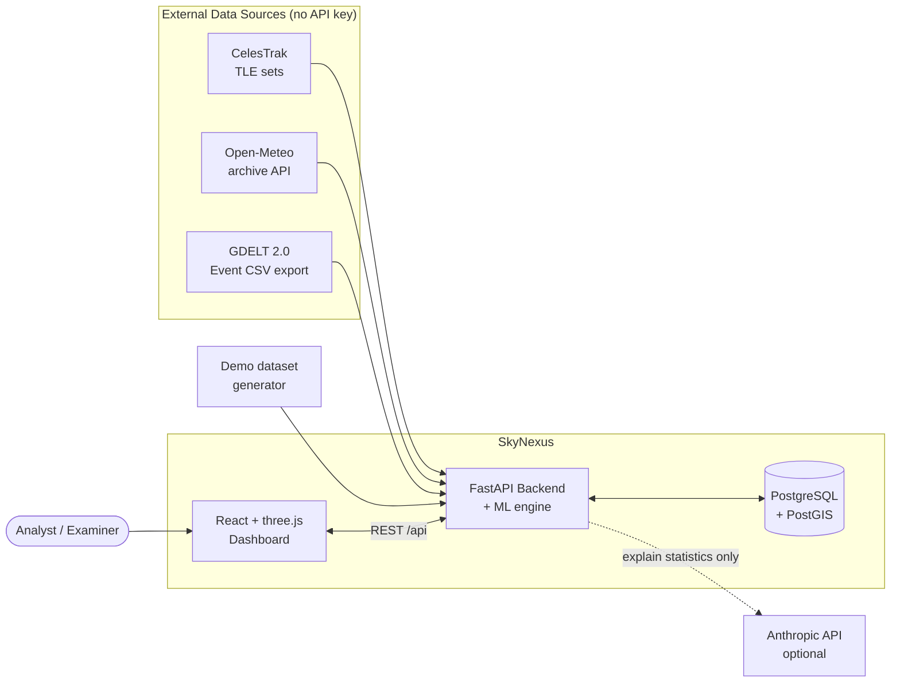
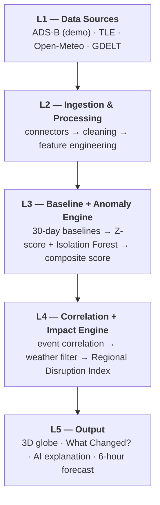
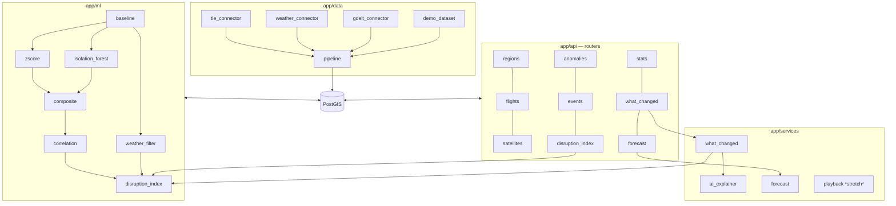
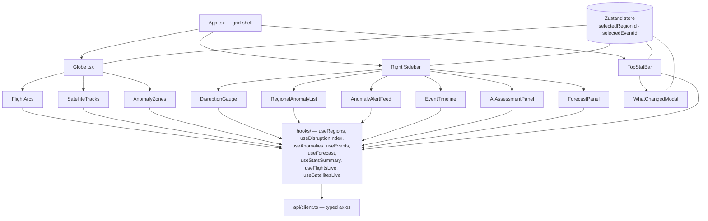
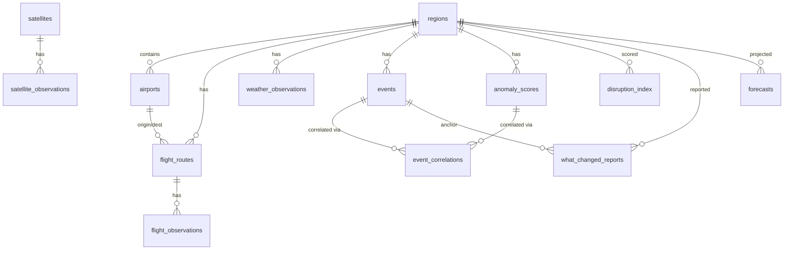
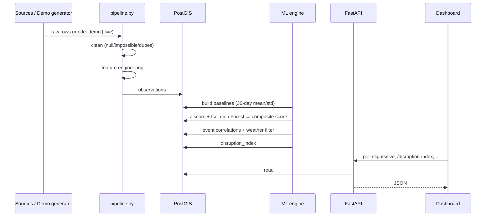
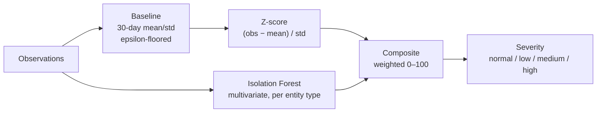
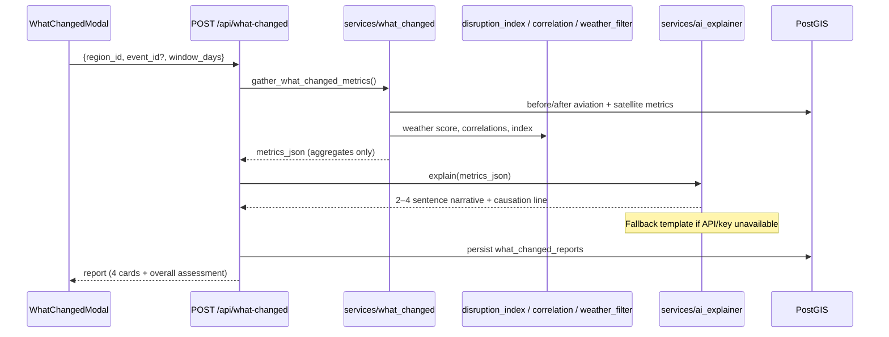
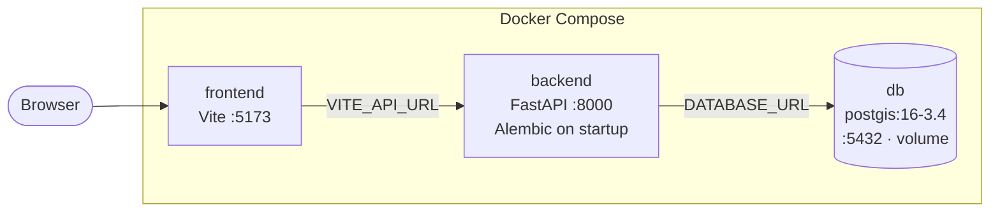

# SkyNexus — System Architecture

**Global Activity Anomaly & Impact Intelligence System**

SkyNexus fuses aviation (ADS-B), satellite (TLE), weather (Open-Meteo) and global-event (GDELT) data, detects anomalies against 30-day baselines, correlates them with real-world events, scores a Regional Disruption Index (0–100), and explains the result in plain language **without ever asserting causation**.

---

## 1. Design Principles

| Principle | How the architecture enforces it |
|---|---|
| **Correlation, not causation** | The AI explainer receives only computed statistics (never raw rows), is prompted never to assert a cause, and every output ends with a causation disclaimer. The UI footer disclaimer is always visible. |
| **Baseline before anomaly** | An anomaly is only meaningful relative to a normal pattern, so the baseline builder (L3) is a hard prerequisite for scoring, correlation and the index. |
| **Rule out the obvious first** | A weather-explanation filter runs before escalation, removing the most common false alarm (storm-driven diversions). |
| **Provenance on every record** | Every observation/event table carries `source` and `ingested_at`. |
| **Explainable over clever** | Z-score + Isolation Forest, weighted-average index, and a simple statistical forecast — each defensible in a viva. Tunable weights are named constants, not magic numbers. |
| **Demo-first, live-ready** | A synthetic dataset drives the end-to-end demo; real connectors plug into the same ingestion interface. |

---

## 2. System Context



---

## 3. Five-Layer Pipeline



| Layer | Responsibility | Key modules |
|---|---|---|
| **L1** | Raw inputs | CelesTrak, Open-Meteo, GDELT, `demo_dataset.py` |
| **L2** | Normalize into the schema | `tle_connector.py`, `weather_connector.py`, `gdelt_connector.py`, `pipeline.py` |
| **L3** | Decide what is "unusual" | `baseline.py`, `zscore.py`, `isolation_forest.py`, `composite.py` |
| **L4** | Decide what it might relate to, and how severe | `correlation.py`, `weather_filter.py`, `disruption_index.py` |
| **L5** | Present and explain | FastAPI routers, `what_changed.py`, `ai_explainer.py`, `forecast.py`, React UI |

---

## 4. Technology Stack

| Concern | Choice |
|---|---|
| Frontend | React + TypeScript (Vite), three.js, recharts, axios, zustand |
| Backend | Python 3.11, FastAPI, SQLAlchemy, GeoAlchemy2, Alembic, pydantic-settings |
| Database | PostgreSQL 16 + PostGIS 3.4 |
| ML | scikit-learn (Isolation Forest), pandas, numpy, statsmodels (forecast), sgp4 (orbit propagation) |
| AI explanation | Anthropic API (optional; deterministic template fallback) |
| Packaging | Docker Compose (db, backend, frontend) |

---

## 5. Component Architecture

### 5.1 Repository Layout

```
skynexus/
├── backend/
│   ├── app/
│   │   ├── api/        # FastAPI routers (one per resource)
│   │   ├── core/       # config.py, db.py
│   │   ├── data/       # connectors, demo generator, pipeline, seed
│   │   ├── ml/         # baseline, zscore, isolation_forest, composite,
│   │   │               #   correlation, weather_filter, disruption_index
│   │   ├── services/   # what_changed, ai_explainer, forecast, playback
│   │   ├── models/     # SQLAlchemy models
│   │   └── schemas/    # Pydantic response models
│   ├── notebooks/      # validation.ipynb
│   ├── tests/
│   └── alembic/        # migrations
├── frontend/src/
│   ├── components/     # sidebar panels, modal
│   ├── hooks/          # data-fetching hooks
│   ├── api/            # typed axios client
│   ├── three/          # Globe + layers
│   └── theme/          # design tokens
├── docker-compose.yml
└── README.md
```

### 5.2 Backend Modules



**Layering rule:** routers → services → ml → models/DB. Routers never contain analytics logic; ML modules never import from `api/`.

### 5.3 Frontend Structure



The **Globe** owns only the sphere, lighting and camera; data layers attach through an imperative layer API so each layer is independently replaceable. All panels degrade independently — one failing endpoint never blanks the dashboard.

---

## 6. Data Architecture

### 6.1 Entity Relationship Overview



### 6.2 Table Groups

| Group | Tables | Notes |
|---|---|---|
| **Reference** | `regions`, `airports`, `flight_routes`, `satellites` | Seeded / slowly changing |
| **Observations** | `flight_observations`, `satellite_observations`, `weather_observations`, `events` | Append-only; carry `source` + `ingested_at`; PostGIS geometry with GiST indexes |
| **Engine** | `baselines`, `anomaly_scores`, `event_correlations` | Derived; recomputable from observations |
| **Output** | `disruption_index`, `what_changed_reports`, `forecasts` | Derived + `metrics_json` (JSONB) for report payloads |

Key indexes: GiST on every geometry column; btree on `flight_observations.timestamp`, `events(region_id, event_date)`, `anomaly_scores(region_id, timestamp)`.

### 6.3 Data Flow



---

## 7. Analytics Engine

### 7.1 Anomaly Scoring (L3)



- **Z-score** catches single-feature deviations; **Isolation Forest** catches *combined* deviations a single z-score would miss.
- Composite weights (`Z_WEIGHT`, `IFOREST_WEIGHT`) are named constants.
- The Isolation Forest's inverted `decision_function` is rescaled so higher = more anomalous.

### 7.2 Correlation + Weather Filter (L4)

`confidence_score = f(temporal_proximity, geographic_overlap, anomaly composite)` with explicit named weights.

- **Temporal proximity:** decays to 0 at the ±72 h window edge.
- **Geographic overlap:** PostGIS `ST_Distance`, decaying to 0 at a max distance.
- **Weather explanation:** compares `storm_index` against the region's own weather baseline. **LOW** means weather does *not* explain the deviation, so escalation continues.

### 7.3 Regional Disruption Index

| Component | Default weight | Source |
|---|---|---|
| Flight anomaly | 0.25 | mean composite of route anomalies |
| Event relevance | 0.20 | mean correlation confidence |
| Airspace | 0.20 | share of flights above deviation threshold |
| Airport activity | 0.15 | \|% volume change vs baseline\| |
| Satellite | 0.10 | mean composite of satellite anomalies over region |
| Weather | 0.10 | weather-explanation score (inverse-weighted) |

Output: `composite_index` (0–100), `severity_label` (normal < 40 … high ≥ 70), and `confidence_pct` (from sample sizes / data completeness). All weights and thresholds are named constants so they can be retuned against the validation case.

### 7.4 Forecast

A deliberately simple, explainable method (e.g. Holt's linear smoothing) projects three metrics — flight congestion, route deviation, airport pressure — 6 hours ahead from the trailing ~72 h, with a naive residual-std confidence band. Gradient-boosted time-series models are documented future work.

---

## 8. "What Changed?" Flow (Hero Feature)



The **guardrail boundary** sits between `SVC` and `AI`: only aggregated `metrics_json` crosses it.

---

## 9. API Surface

| Method | Endpoint | Purpose | Consumer |
|---|---|---|---|
| GET | `/api/health` | Liveness | Ops |
| GET | `/api/regions`, `/api/regions/{id}` | Regions + latest index | Zones, list |
| GET | `/api/flights/live` | Latest flight positions + `is_anomalous` | FlightArcs |
| GET | `/api/satellites/live` | Latest satellite positions | SatelliteTracks |
| GET | `/api/anomalies` | Filterable anomaly list | Alert feed |
| GET | `/api/events` | Filterable events | Timeline |
| GET | `/api/disruption-index` | Latest index per region | Gauge, list, zones |
| GET | `/api/stats/summary` | Four headline counters | Top bar |
| POST | `/api/what-changed` | Generate before/after report | Modal |
| GET | `/api/forecast/{region_id}` | 6-hour projection | Forecast panel |
| GET | `/api/clock` | Simulated clock *(stretch)* | LIVE indicator |

OpenAPI docs are served at `/docs`. Responses use Pydantic models; PostGIS geometry is exposed as plain `lat`/`lon` floats.

---

## 10. Deployment



- `docker compose up` brings up all three services; migrations run automatically at backend start.
- One-command demo: `python -m app.scripts.bootstrap_demo` runs migrate → seed regions → generate demo data → ingest → baselines → anomaly scoring → correlation/weather filter → disruption index.
- Config via environment: `DATABASE_URL`, `ANTHROPIC_API_KEY` (optional), `ENV`, `VITE_API_URL`, `SIMULATE_LIVE` (optional).

---

## 11. Validation & Testing

| Level | What is checked |
|---|---|
| Unit | Baseline mean/std and zero-std guard; z-score values; Isolation Forest ranks planted outliers higher; composite severity buckets; correlation decay; weather filter LOW vs HIGH; forecast trend direction |
| Integration | Pipeline end-to-end row counts; each endpoint against a seeded test DB; `/api/what-changed` matches the index validation |
| **Scenario validation** | On the demo T0 event, the post-event 7-day window scores HIGH while the pre-event window stays in the normal band |
| Notebook | `validation.ipynb` reproduces the before/after volume, correlation-confidence and index-breakdown charts live from pipeline output, plus an anomaly-score timeline with T0 marked |

---

## 12. Limitations & Constraints

- **No causal claims.** Outputs are statistical anomalies and correlations only.
- **Flights are demo data.** A real historical ADS-B pull is out of scope; live mode covers satellite, weather and events only.
- **Latency.** Public feeds are batch/near-real-time, not streaming; "LIVE" is a simulated clock in demo mode.
- **Narrow GDELT scope.** Restricted to a bounded date range and region bounding box rather than a global pull.
- **Simple forecasting.** Chosen for explainability, not accuracy.
- **Tunable, not proven, weights.** Index weights are documented defaults calibrated against one validation scenario.

---

## 13. Extension Points

| Area | Extension |
|---|---|
| Data | Real ADS-B feed behind the same ingestion interface |
| Streaming | Replace polling with WebSocket/SSE; Kafka-style ingestion |
| ML | Gradient-boosted forecasting; learned (rather than fixed) index weights |
| Ops | Scheduler (e.g. APScheduler/Celery) for rolling index recompute |
| Frontend | Additional globe layers via the existing layer API |
