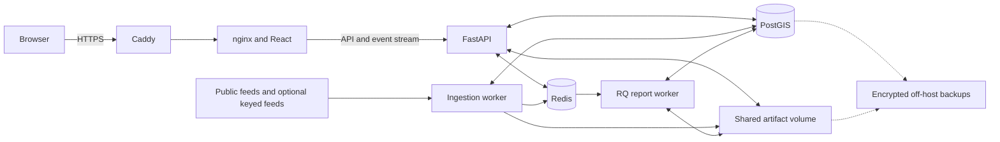

# SkyNexus hosting plan

Prepared 27 November 2026. The working assumption is a low-cost, always-on academic demo. Keep provider credentials in the root, Git-ignored `.env` for local development until deployment is requested. This plan does not provision paid resources or upload keys.

## Recommended deployment

Start on **one DigitalOcean Basic Droplet with 2 vCPUs, 4 GiB RAM and 80 GiB SSD**. Run the existing Docker Compose services behind Caddy HTTPS, with persistent PostGIS, Redis and shared artifact volumes. This is a starting allocation for a small evaluator audience; a load test must establish its capacity. Build images in CI so scientific dependency installation does not compete with live collection on the server.

The application needs continuous ingestion, a report queue, database history and durable evidence files. A single VM keeps these services and their shared files together at a modest initial cost. OS patching, database maintenance and recovery become the operator's responsibility, and one host is a single point of failure. Choose the managed alternative below if reducing that maintenance matters more than the monthly budget.

Prefer Bangalore (`blr1`) for an India-based evaluation audience, with Singapore (`sgp1`) as another candidate. Both are listed for Basic Droplets in [DigitalOcean regional availability](https://docs.digitalocean.com/platform/regional-availability/). Confirm capacity and measure latency before selecting the region.

| Component | Deployment | Purpose |
| --- | --- | --- |
| HTTPS gateway | Caddy, public ports 80/443 | One public origin for the interface and API. Persist certificate state. |
| Frontend | Existing nginx container, internal port 80 | React assets and `/api` reverse proxy. |
| Backend | Existing FastAPI container, internal port 8000 | Authentication, queries, server-sent events and downloads. |
| Ingestion | One `python -m app.worker` process | Continuous collectors, analysis, retention and event publishing. |
| Analysis | One RQ `research` worker | Queued report generation. |
| PostGIS | PostgreSQL 16 container, private network | Persistent database volume and independent logical backups. |
| Redis | Existing append-only Redis container, private network | Durable queue and event streams. |
| Evidence | Shared `research_artifacts` volume | Same `/app/artifacts` path in web, ingestion and analysis; independent off-host backup. |



The repository also has a Vercel integration that reports successful preview checks. This check does not validate persistent ingestion, queued reports, PostGIS or artifact storage. Keep a single HTTPS origin for the full application so login cookies and event streams can be verified together.

## Budget and alternative

Prices checked against official provider pages on 27 November 2026; confirm checkout totals before provisioning. Taxes, a domain, excess usage and optional data/AI subscriptions are additional.

| Option | Initial infrastructure estimate per month | Tradeoff |
| --- | --- | --- |
| Recommended DigitalOcean VM | $24 compute + $7.20 daily VM backups = **$31.20**, plus independent backup storage | Lowest initial cost of these two layouts; self-managed services and recovery. Plan roughly **$35–45** for a small deployment, subject to actual storage/traffic. |
| Managed Render layout below | **$104 compute**, plus DB storage, R2, bandwidth and any workspace upgrade | Separate managed services and managed database recovery; plan roughly **$120–150** subject to usage. |

DigitalOcean lists the 4 GiB / 2 vCPU Basic Regular plan at [US$24/month](https://www.digitalocean.com/pricing/droplets). Its [daily backup plan adds 30%](https://docs.digitalocean.com/products/backups/details/pricing/). VM image backups complement application-consistent logical backups; they do not replace the recovery drill below. If the measured workload needs 8 GiB / 4 vCPUs, that Basic Regular tier is listed at $48 before backups.

### Managed Render alternative

Use one web service, two always-on workers, PostgreSQL/PostGIS and Redis-compatible Key Value, with a private R2 bucket shared by all application processes. Serve React and FastAPI together using the root Dockerfile. Keep all Render services in one region and ingestion at one instance. Render documents [continuous background workers](https://render.com/docs/background-workers) and [PostGIS/pgcrypto support](https://render.com/docs/postgresql-extensions).

| Component | Initial allocation | Purpose and command |
| --- | --- | --- |
| `skynexus-web` | 1 CPU, 2 GB RAM | Root Dockerfile builds React and FastAPI. Default `./entrypoint.sh` prepares the DB and starts Uvicorn on `$PORT`. |
| `skynexus-ingestion` | 1 CPU, 2 GB RAM | `python -m app.worker`: live collectors, AISstream subscription, feature analysis, event publishing and retention. |
| `skynexus-analysis` | 1 CPU, 2 GB RAM | `rq worker research --url "$REDIS_URL"`: queued report jobs. Use the existing shell-wrapped command in `render.yaml`. |
| `skynexus-db` | PostgreSQL 16, 1 GB RAM initially | Durable observations, source state, sessions, reports, features and outbox. Enable `postgis` and `pgcrypto`. |
| `skynexus-events` | Paid 256 MB initially | Redis-compatible event streams and RQ queue; persistence enabled and `noeviction`. |
| Private R2 bucket | Standard storage | Shared evidence, exports and retention archives available to all three application services. |
| HTTPS origin | Render subdomain initially | Add a custom domain after validation. TLS, DNS and cookie origin must agree. |

These allocations are starting estimates, not load-test results. Measure before increasing traffic. [Current compute IDs](https://render.com/docs/compute-plans) are `1c-2g`, Postgres `0.5c-1g` and Key Value `256mb`; the blueprint's legacy names remain aliases. Render [supports PostGIS and pgcrypto](https://render.com/docs/postgresql-extensions).

The Render compute estimate is three 2 GB application services at $25 each, 1 GB Postgres at $19, and 256 MB Key Value at $10. [Render pricing](https://render.com/pricing) lists storage and workspace charges separately. A Render service disk is [accessible to only one service instance](https://render.com/docs/disks), so use object storage for shared evidence in this layout.

R2 Standard includes a monthly allowance of 10 GB-month storage, one million Class A operations and ten million Class B operations. Beyond the allowance, storage is $0.015 per GB-month, Class A operations $4.50 per million and Class B operations $0.36 per million. [R2 pricing](https://developers.cloudflare.com/r2/pricing/) also lists free Internet egress. This is a usage allowance, not a cap on charges.

## Required changes before hosting

These are implementation tasks for the hosting phase; the current development Compose file and Render blueprint are starting points.

### Both layouts

1. Set `PUBLIC_ORIGIN` to the exact HTTPS origin and `COOKIE_SECURE=true`. Choose whether `DEMO_DIRECT_LOGIN=true` is appropriate for a public academic demo; password access is the restricted option.
2. Make migrations a serialized release step. Web startup currently applies migrations/seeds; workers need a schema-readiness gate. Pause ingestion, drain report jobs, migrate once, start compatible web, then start workers. Do not let overlapping ingestion deployments duplicate subscriptions.
3. Add DB/Redis-aware readiness and worker heartbeat monitoring. `/api/health` currently proves only that FastAPI can answer.
4. Extend CI to run the backend test suite against PostGIS and the frontend production build. The existing GitHub validation installs Python dependencies and runs `compileall`; its green status is not a full regression test. Until this is improved, retain explicit release verification.
5. Add limits for concurrent reports, dataset uploads and resource-heavy scientific processing; size DB pools for the actual connection budget. Keep mathematical library threads capped and benchmark replay/report concurrency before public access.
6. Implement scheduled encrypted off-host backups, alerts and restore verification. Exclude `.env`, private reports and backups from source control and images.

### DigitalOcean VM

1. Create a dedicated production Compose configuration. Remove public DB/API/frontend bindings; expose only Caddy on 80/443. Restrict SSH to operator access using a cloud firewall, and keep Redis internal.
2. Replace the checked-in development DB credentials with server-only secrets and use the same credentials in application connection strings and DB health checks. The current Compose environment hardcodes these values and overrides secure cookies to `false`; copying `.env` alone does not correct them.
3. Add Caddy configuration for the chosen domain and persist its data directory. Route to the internal nginx service and verify unbuffered event delivery. [Caddy automatic HTTPS](https://caddyserver.com/docs/automatic-https) needs the domain pointing to the server, reachable 80/443 and writable persistent certificate storage.
4. Give web and report services `LIVE_INGEST=0`, ingestion `LIVE_INGEST=1`, and all three `ENV=production` / `DATA_MODE=live`. Keep one collector process. Set restart/resource policies and Redis `noeviction`; the development DB's 20-connection limit needs reconciliation with application pools.
5. Preserve database, Redis, artifact and certificate volumes across releases. Use the local archive storage mode with the shared artifact path for this layout. Keep backup copies off the VM. Monitor disk growth and reserve enough free space for DB dumps and retention archives.
6. Build versioned images in CI, deploy a pinned commit/image and retain the previous release. Configure OS security updates and an explicit maintenance owner.

### Render

The checked-in `render.yaml` needs these additional changes before use:

1. Override `LIVE_INGEST` to `1` on **ingestion**. Its shared environment currently sets `0` for every service, which disables all live acquisition. Keep web and report processing at `0`; set `DATA_MODE=live` explicitly on all three.
2. Add the exact `PUBLIC_ORIGIN` and choose public demo or password login. The blueprint currently has neither an explicit origin nor direct-demo access enabled.
3. Configure shared private object storage on web, ingestion and analysis. Local service filesystems do not provide shared durable archives. Supply `ARCHIVE_STORAGE=r2` and all four R2 variables in `CONFIGURATION.md`.
4. Add provider credentials to ingestion through deployment environment settings when deployment is authorized. Leave actual values out of the blueprint, examples, frontend variables and built images. The local `.env` is excluded from the root Docker build context.
5. Use the serialized release/migration checks above. Configure deployment after full CI passes, with a separate staging environment.

## Environment and access

| Setting | Services | Hosted value or action |
| --- | --- | --- |
| `DATABASE_URL` | Web, ingestion, analysis | Private Compose database or managed internal connection string. The app normalizes the SQLAlchemy driver. |
| `REDIS_URL` | Web, ingestion, analysis | Internal Redis/Key Value connection string. |
| `ENV` / `DATA_MODE` | All three | `production` / `live`. |
| `PUBLIC_ORIGIN` | Web | Exact `https://` origin, no path; update when switching to a custom domain. |
| `COOKIE_SECURE` | Web | `true`. |
| `DEMO_DIRECT_LOGIN` | Web | `true` for a public academic demo; `false` for restricted access. |
| `DEMO_EMAIL` / `DEMO_PASSWORD_HASH` | Web | Provision password access if restricted; generate with `python -m app.provision_demo`. |
| `LIVE_INGEST` | Ingestion | `1`; web/analysis use `0`. |
| `AISSTREAM_API_KEY` | Ingestion | Copy the local value into service environment settings only when deploying. |
| Other provider keys | Ingestion | Configure only the feeds being enabled; see `CONFIGURATION.md`. |
| `ARCHIVE_STORAGE` / R2 settings | All three | VM: local mode and identical shared volume/path. Render: `r2`, private endpoint, bucket, bucket-scoped access key ID and secret. |
| `ANTHROPIC_API_KEY` / `ANTHROPIC_MODEL` | Report-processing services | Optional; deterministic reports work without them. |
| `EWDS_API_TOKEN` | Service running an explicit download | Optional, with accepted dataset terms and a bounded scientific request. |

Use internal DB/Redis networking and keep external access disabled. The browser receives normalized data through authenticated application APIs; it never needs provider keys. Historical replay and the keyless collectors can run without paid provider credentials. The VM route needs a hosting account, SSH access and a domain/subdomain; an automation API token is optional for manual provisioning. Separate off-host backup credentials are required for the chosen backup destination. Local keys remain in the project `.env` until deployment is requested. Password provisioning here is a demo-account mechanism; separate production user management is required for a multi-user organization.

## AISstream operation and coverage

The current collector subscribes to `PositionReport` messages in three latitude/longitude boxes: Florida/Bahamas (23 to 27, −83 to −78), New England (41 to 43.5, −72.5 to −69.5), and Red Sea/Suez surroundings (12 to 30, 32 to 44). It does not request worldwide ship coverage, Class B reports or historical tracks. The app stores vessel identity/name, coordinates, speed, course and timestamps as maritime observations.

Open **Sources → AISStream**, then **Domain signals → Maritime** in the live dataset. A configured key alone does not prove authentication or receipt; require a recent successful acquisition and stored positions. The current globe renders the original aviation/orbital layers; vessel observations are available in Maritime signals and their detail view.

AISstream requires backend WSS access to `stream.aisstream.io:443`, compression and a subscription within three seconds. It limits subscribed account connections and open connections from an IP to three each. Keep one ingestion instance; allow connection headroom for deployment overlap and local development. [AISstream documentation](https://aisstream.io/documentation) describes these constraints. Provider data and vessel transponders can have coverage gaps.

## Deployment sequence

### Recommended VM route

1. Complete the production configuration and full CI tasks above. Re-run the 85-test backend suite and frontend build, then check the production Compose configuration with placeholder secrets.
2. Confirm the spending limit, account, Bangalore/Singapore region, domain and public-demo/restricted access mode. Provision only when deployment is requested. Use a separate staging database and artifact directory; do not copy development sessions or private reports to the public demo.
3. Create the VM, SSH access and firewall. Install supported Docker/Compose, create protected server secrets and persistent volumes, and deploy the pinned images with collectors stopped.
4. Run migrations/seeds once. Start web, verify HTTPS and authentication, then start one ingestion worker and the report worker.
5. Run all acceptance checks below, a bounded concurrent-user test and a 24-hour ingestion soak. Use a temporary staging subdomain; confirm memory and disk headroom before launch. Increase capacity if measurements require it.
6. Configure daily VM backups plus independent encrypted logical/artifact backups. Restore a backup into an isolated stack and record recovery time before public launch.
7. Point the final domain to the server, issue/verify TLS, set `PUBLIC_ORIGIN`, repeat authentication and streaming checks, and record the deployed commit, migration revision and rollback image. Preserve unrelated DNS records.

### Managed Render route

1. Finish the blueprint changes above and run local verification. Keep live credentials out of CI logs and use synthetic/mock inputs for automated provider tests.
2. Create one Render project, paid Postgres and paid Key Value in the selected region. Create a private R2 bucket and bucket-scoped credentials. Confirm the monthly quote and spending alerts.
3. Configure the service environment matrix. Build the root Dockerfile for all three processes. Use a staging database and bucket separate from production.
4. Deploy web first. Confirm extension creation, `alembic upgrade head`, idempotent seeding, authentication and static frontend delivery. Start ingestion and analysis after migrations complete.
5. Run the acceptance checks below against the Render URL. Keep the deployment private/restricted until checks pass if the intended launch is restricted.
6. Add the custom domain using Render's displayed DNS records, wait for HTTPS, update `PUBLIC_ORIGIN`, redeploy web, and repeat login/event-stream checks. Keep unrelated DNS records intact.
7. Enable monitoring and backups, complete a recovery drill, then enable deployments after CI passes. Record the deployed commit, environment names, DB migration revision and rollback image.

## Launch acceptance

- `/api/health` answers; protected `/api/sources` rejects an anonymous request; the selected login method works with secure cookies on the real origin.
- At least two enabled keyless feeds update independently; pausing/viewing synthetic data does not relabel live records. A provider timeout is shown as an acquisition problem.
- If AISstream is enabled, Sources reports a recent `last_success` and increasing records; `/api/signals/maritime?data_mode=live` returns actual vessel observations.
- `/api/stream` delivers events and resumes after reconnect; the proxy does not buffer events.
- Generate a queued report, confirm that analysis consumes it, and download its evidence archive from web. Verify unauthenticated access is rejected and artifact ownership checks match the selected login model. Direct demo sessions share the demo identity.
- Restart each service; database records and shared artifacts survive. Confirm archive retention succeeds and no local-only evidence is lost.
- Run a bounded concurrent-user check and a 24-hour ingestion soak. Record memory, database growth, queue age, response latency and provider failure rate before widening coverage.

Local checks:

```bash
docker compose exec backend python -m pytest -q
docker compose exec ingestion python -m app.check_config
cd frontend
npm ci
npm run build
```

## Backups and recovery

For the VM route, schedule the existing `python -m app.backup` CLI for DB and local artifacts during a coordinated maintenance window so artifact writes and retention do not race the backup. Encrypt and copy the bundle and checksum manifest off-host; a file in `./backups` on the same disk is not disaster recovery. Keep Redis append-only persistence for restarts, and document queue reconciliation after a restore. VM disk backups alone are not proof of a consistent application backup.

For Render, use paid Postgres point-in-time recovery and an additional encrypted daily logical export stored separately from the application account. Render documents a three-day recovery window for Hobby and seven days for Pro or higher; confirm the selected workspace policy. Recovery creates a new DB for validation before switching connection strings. See [Render backups](https://render.com/docs/postgresql-backups).

Back up the R2 object namespace separately and preserve its mapping to artifact rows and checksums. A content-addressed key is not a backup: retain independent object copies and a manifest aligned with the database snapshot. Do not expire archive objects while database references still require them. The existing `python -m app.backup` CLI bundles DB and local artifacts only and deliberately rejects R2 mode; hosted R2 backup orchestration remains to be implemented.

Planning targets: daily independent backups with a 24-hour recovery point objective; aim for a four-hour recovery time and measure it in staging. Managed PITR adds recent DB recovery on the Render route. Restore into a fresh PostGIS DB and separate artifact volume/bucket, validate schema, record counts, login and checksum downloads, then switch all services together. Do not restore over the live database. These are targets, not measured guarantees.

## Monitoring and maintenance

- Check web availability and authenticated DB access; track error rate and response latency.
- Alert when AISstream has no success for five minutes during expected reception; distinguish a quiet coverage area from a dead collector using a worker heartbeat. Other sources need thresholds based on their polling cadence/publication lag.
- Monitor oldest queued job, failed jobs, worker restarts, DB connections/storage, host memory/disk, Redis memory and artifact storage errors. Retain sanitized error classes; omit credential-bearing URLs and payloads from logs.
- Page/notify on sustained failures through the operator's chosen monitoring service. The app does not currently implement external alert delivery.
- Review costs and database growth weekly initially. Raw normalized observations archive after seven days, hourly features retain 180 days, and DB stream events retain one day; legacy retention follows `RETENTION_DAYS`. Object storage needs an explicit long-term archive policy.
- Run monthly recovery drills, patch dependencies regularly, and rotate hosted credentials when access changes. Measure growth before increasing AIS coverage. At 10 positions/second, one day adds 864,000 observations plus associated events and indexes; benchmark actual storage per row.

Keep ingestion at one replica until collectors have distributed ownership. Scale report workers for queue backlog and web for concurrent requests after making migrations independent of startup. Each process can open up to ten DB connections with current pool settings; budget connections for replicas, RQ subprocesses, migrations and administrative access.

## Rollback

Record an immutable known-good image/commit before every release and back up before schema changes. Pause ingestion and report jobs, roll application processes back together, then repeat authentication, source and artifact checks. Prefer additive, backward-compatible migrations. An application rollback does not undo schema/data changes; restore a fresh database and matching object snapshot if compatibility is lost, accepting the documented recovery window. Resume one ingestion process only after validation.

## Completion checklist

- [ ] Production Compose or Render blueprint, storage, full CI and release sequencing changes implemented.
- [ ] Hosting account, region, budget and access mode selected.
- [ ] Staging deployment and 24-hour ingestion soak accepted.
- [ ] Hosted secrets configured when deployment is requested.
- [ ] DNS, HTTPS, origin, authentication and stream delivery verified.
- [ ] Database/object backups, external monitoring and recovery drill verified.
- [ ] Production release and rollback record captured.
