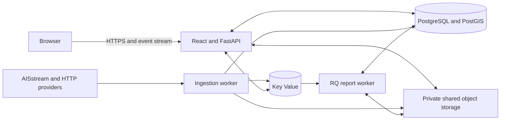

# SkyNexus hosting plan

Prepared 27 November 2026. Keep provider credentials in the root, Git-ignored `.env` for local development for now. This plan does not provision cloud resources or upload keys.

## Recommended deployment

Use Render for the web service, two always-on workers, PostgreSQL/PostGIS and Redis-compatible Key Value, with a private Cloudflare R2 bucket for shared artifacts. This fits the existing Docker image and process model. Serve the React build and `/api` from one HTTPS origin so login cookies and server-sent events work together.

Start with one instance of each process, all Render resources in the same region. Singapore is a candidate for an India-based audience; confirm availability and actual latency before choosing it. Keep the ingestion worker running continuously for the AISstream WebSocket. Render supports [continuous background workers](https://render.com/docs/background-workers).

| Component | Initial allocation | Purpose and command |
| --- | --- | --- |
| `skynexus-web` | 1 CPU, 2 GB RAM | Root Dockerfile builds React and FastAPI. Default `./entrypoint.sh` prepares the DB and starts Uvicorn on `$PORT`. |
| `skynexus-ingestion` | 1 CPU, 2 GB RAM | `python -m app.worker`: live collectors, AISstream subscription, feature analysis, event publishing and retention. |
| `skynexus-analysis` | 1 CPU, 2 GB RAM | `rq worker research --url "$REDIS_URL"`: queued report jobs. Use the existing shell-wrapped command in `render.yaml`. |
| `skynexus-db` | PostgreSQL 16, 1 GB RAM initially | Durable observations, source state, sessions, reports, features and outbox. Enable `postgis` and `pgcrypto`. |
| `skynexus-events` | Paid 256 MB initially | Redis-compatible event streams and RQ queue; persistence enabled and `noeviction`. |
| Private R2 bucket | Standard storage | Shared evidence, exports and retention archives available to all three application services. |
| HTTPS origin | Render subdomain initially | Add a custom domain after validation. TLS, DNS and cookie origin must agree. |

These allocations are starting estimates, not load-test results. Measure before increasing traffic. [Current compute IDs](https://render.com/docs/compute-plans) are `1c-2g`, Postgres `0.5c-1g` and Key Value `256mb`; the blueprint's legacy names remain aliases. Render [supports PostGIS and pgcrypto](https://render.com/docs/postgresql-extensions).



## Budget

The initial compute estimate is **US$104 per month**: three 2 GB application services at $25 each, 1 GB Postgres at $19, and 256 MB Key Value at $10. These are the listed compute prices checked on [Render pricing](https://render.com/pricing); confirm the final checkout total before provisioning. Database storage, extra bandwidth/build usage, workspace upgrades, taxes, domain registration and optional AI/provider usage are additional. Reserve roughly **$120–150 per month** as a planning allowance for a small research deployment, subject to measured storage and traffic.

R2 Standard includes a monthly allowance of 10 GB-month storage, one million Class A operations and ten million Class B operations. Beyond the allowance, storage is $0.015 per GB-month, Class A operations $4.50 per million and Class B operations $0.36 per million. [R2 pricing](https://developers.cloudflare.com/r2/pricing/) also lists free Internet egress. This is a usage allowance, not a cap on charges.

For a lower infrastructure budget, an alternative is one Linux VM running the existing Compose stack with a TLS reverse proxy, persistent DB/Redis/artifact volumes and off-machine backups. Budget an estimated $25–60 monthly for the VM and backup storage, then obtain a provider quote. This option makes OS patching, database recovery and all-service outages the operator's responsibility. Remove public DB/API port bindings, replace default DB credentials, and fix the Compose secure-cookie override before using it publicly.

## Required changes before hosting

The checked-in `render.yaml` is a starting blueprint; it needs these changes before use:

1. Override `LIVE_INGEST` to `1` on **ingestion**. Its shared environment currently sets `0` for every service, which disables all live acquisition. Keep web and report processing at `0`; set `DATA_MODE=live` explicitly on all three.
2. Add the exact `PUBLIC_ORIGIN` and choose public demo or password login. The blueprint currently has neither an explicit origin nor direct-demo access enabled.
3. Configure shared private object storage on web, ingestion and analysis. Local service filesystems do not provide shared durable archives. Supply `ARCHIVE_STORAGE=r2` and all four R2 variables in `CONFIGURATION.md`.
4. Add provider credentials to ingestion through deployment environment settings when deployment is authorized. Leave actual values out of the blueprint, examples, frontend variables and built images. The local `.env` is excluded from the root Docker build context.
5. Make migrations a serialized release step. Currently only the web startup applies migrations/seeds; workers can start before the schema is ready. For the first launch, provision the database and start web to completion before starting workers. For later releases, stop ingestion, drain/pause report jobs, run migrations once, and deploy compatible services in order. A dedicated release command and worker readiness gate are follow-up implementation work.
6. Add database-aware readiness checks and worker heartbeat monitoring. `/api/health` currently checks only that FastAPI can answer; it does not prove DB, Redis, object storage or provider health.
7. Add CI for the backend test suite against PostGIS and the frontend production build. Until checks exist, deploy manually; then configure deployment after passing checks.

## Environment and access

| Setting | Services | Hosted value or action |
| --- | --- | --- |
| `DATABASE_URL` | Web, ingestion, analysis | Managed internal database connection string; the app normalizes the SQLAlchemy driver. |
| `REDIS_URL` | Web, ingestion, analysis | Managed internal Key Value connection string. |
| `ENV` / `DATA_MODE` | All three | `production` / `live`. |
| `PUBLIC_ORIGIN` | Web | Exact `https://` origin, no path; update when switching to a custom domain. |
| `COOKIE_SECURE` | Web | `true`. |
| `DEMO_DIRECT_LOGIN` | Web | `true` for a public academic demo; `false` for restricted access. |
| `DEMO_EMAIL` / `DEMO_PASSWORD_HASH` | Web | Provision password access if restricted; generate with `python -m app.provision_demo`. |
| `LIVE_INGEST` | Ingestion | `1`; web/analysis use `0`. |
| `AISSTREAM_API_KEY` | Ingestion | Copy the local value into service environment settings only when deploying. |
| Other provider keys | Ingestion | Configure only the feeds being enabled; see `CONFIGURATION.md`. |
| `ARCHIVE_STORAGE` / R2 settings | All three | `r2`, private endpoint, bucket, bucket-scoped access key ID and secret. |
| `ANTHROPIC_API_KEY` / `ANTHROPIC_MODEL` | Report-processing services | Optional; deterministic reports work without them. |
| `EWDS_API_TOKEN` | Service running an explicit download | Optional, with accepted dataset terms and a bounded scientific request. |

Use internal DB/Key Value networking and keep external access disabled. The browser receives normalized data through authenticated application APIs; it never needs provider keys. Local keys remain in the project `.env` until deployment is requested. Password provisioning here is a demo-account mechanism; separate production user management is required for a multi-user organization.

## AISstream operation and coverage

The current collector subscribes to `PositionReport` messages in three latitude/longitude boxes: Florida/Bahamas (23 to 27, −83 to −78), New England (41 to 43.5, −72.5 to −69.5), and Red Sea/Suez surroundings (12 to 30, 32 to 44). It does not request worldwide ship coverage, Class B reports or historical tracks. The app stores vessel identity/name, coordinates, speed, course and timestamps as maritime observations.

Open **Sources → AISStream**, then **Domain signals → Maritime** in the live dataset. A configured key alone does not prove authentication or receipt; require a recent successful acquisition and stored positions. The current globe renders the original aviation/orbital layers; vessel observations are available in Maritime signals and their detail view.

AISstream requires backend WSS access to `stream.aisstream.io:443`, compression and a subscription within three seconds. It limits subscribed account connections and open connections from an IP to three each. Keep one ingestion instance; allow connection headroom for deployment overlap and local development. [AISstream documentation](https://aisstream.io/documentation) describes these constraints. Provider data and vessel transponders can have coverage gaps.

## Deployment sequence

1. Finish the blueprint changes above and run local verification. Keep live credentials out of CI logs and use synthetic/mock inputs for automated provider tests.
2. Create one Render project, paid Postgres and paid Key Value in the selected region. Create a private R2 bucket and bucket-scoped credentials. Confirm the monthly quote and spending alerts.
3. Configure the service environment matrix. Build the root Dockerfile for all three processes. Use a staging database and bucket separate from production.
4. Deploy web first. Confirm extension creation, `alembic upgrade head`, idempotent seeding, authentication and static frontend delivery. Start ingestion and analysis after migrations complete.
5. Run the acceptance checks below against the Render URL. Keep the deployment private/restricted until checks pass if the intended launch is restricted.
6. Add the custom domain using Render's displayed DNS records, wait for HTTPS, update `PUBLIC_ORIGIN`, redeploy web, and repeat login/event-stream checks. Keep unrelated DNS records intact.
7. Enable monitoring and backups, complete a recovery drill, then enable deployments after CI passes. Record the deployed commit, environment names, DB migration revision and rollback image.

## Launch acceptance

- `/api/health` answers; protected `/api/sources` rejects an anonymous request; the selected login method works with secure cookies on the real origin.
- Sources reports AISstream configured, a recent `last_success`, and increasing records. `/api/signals/maritime?data_mode=live` returns actual vessel observations. A provider timeout is shown as an acquisition problem.
- Another keyless feed updates independently; pausing/viewing synthetic data does not relabel live records.
- `/api/stream` delivers events and resumes after reconnect; the proxy does not buffer events.
- Generate a queued report, confirm that analysis consumes it, and download its evidence archive from web. Verify another browser session cannot access that private artifact.
- Restart each service; database records and shared artifacts survive. Confirm archive retention succeeds and no local-only evidence is lost.
- Run a bounded concurrent-user check and a 24-hour ingestion soak. Record memory, database growth, queue age, response latency and provider failure rate before widening coverage.

Local checks:

```bash
docker compose exec backend python -m pytest -q
docker compose exec ingestion python -m app.check_config
cd frontend
npm ci
npm run build
```

## Backups and recovery

Use paid Postgres point-in-time recovery and an additional encrypted daily logical export stored separately from the application account. Render currently documents a three-day recovery window for Hobby and seven days for Pro or higher; confirm the selected workspace policy. Recovery creates a new DB for validation before switching connection strings. See [Render backups](https://render.com/docs/postgresql-backups).

Back up the R2 object namespace separately and preserve its mapping to artifact rows and checksums. A content-addressed key is not a backup: retain independent object copies and a manifest aligned with the database snapshot. Do not expire archive objects while database references still require them. The existing `python -m app.backup` CLI bundles DB and local artifacts only and deliberately rejects R2 mode; hosted R2 backup orchestration remains to be implemented.

Planning targets: daily independent backups with a 24-hour recovery point objective, plus managed PITR for recent DB changes; aim for a four-hour recovery time and measure it in staging. Restore into a fresh PostGIS DB and separate bucket, validate schema, record counts, login and checksum downloads, then switch all services together. Do not restore over the live database.

## Monitoring and maintenance

- Check web availability and authenticated DB access; track error rate and response latency.
- Alert when AISstream has no success for five minutes during expected reception; distinguish a quiet coverage area from a dead collector using a worker heartbeat. Other sources need thresholds based on their polling cadence/publication lag.
- Monitor oldest queued job, failed jobs, worker restarts, DB connections/storage, Redis memory and R2 errors. Retain sanitized error classes; omit credential-bearing URLs and payloads from logs.
- Page/notify on sustained failures through the operator's chosen monitoring service. The app does not currently implement external alert delivery.
- Review costs and database growth weekly initially. Raw normalized observations archive after seven days, hourly features retain 180 days, and DB stream events retain one day; legacy retention follows `RETENTION_DAYS`. Object storage needs an explicit long-term archive policy.
- Run monthly recovery drills, patch dependencies regularly, and rotate hosted credentials when access changes. Measure growth before increasing AIS coverage. At 10 positions/second, one day adds 864,000 observations plus associated events and indexes; benchmark actual storage per row.

Keep ingestion at one replica until collectors have distributed ownership. Scale report workers for queue backlog and web for concurrent requests after making migrations independent of startup. Each process can open up to ten DB connections with current pool settings; budget connections for replicas, RQ subprocesses, migrations and administrative access.

## Rollback

Record an immutable known-good image/commit before every release and back up before schema changes. Pause ingestion and report jobs, roll application processes back together, then repeat authentication, source and artifact checks. Prefer additive, backward-compatible migrations. An application rollback does not undo schema/data changes; restore a fresh database and matching object snapshot if compatibility is lost, accepting the documented recovery window. Resume one ingestion process only after validation.

## Completion checklist

- [ ] Blueprint environment, shared storage and release sequencing changes implemented.
- [ ] Hosting account, region, budget and access mode selected.
- [ ] Staging deployment and 24-hour ingestion soak accepted.
- [ ] Hosted secrets configured when deployment is requested.
- [ ] DNS, HTTPS, origin, authentication and stream delivery verified.
- [ ] Database/object backups, external monitoring and recovery drill verified.
- [ ] Production release and rollback record captured.
