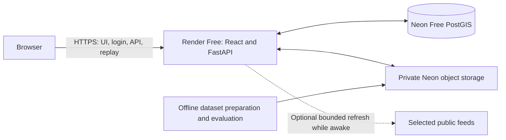

# SkyNexus free sleeping-demo hosting plan

Prepared 27 November 2026. Selected priority: **a free academic demo that can sleep**. Application changes are pushed to `codex/research-workspace-earth-window`. This is a hosting plan; accounts, hosted secrets and deployment acceptance remain future work.

## Recommendation

Use **one Render Free web service** for React and FastAPI together, backed by **Neon Free PostgreSQL/PostGIS**. Use a private Neon Object Storage bucket for historical cases, evaluations and evidence, after validating its S3 compatibility with this application. Start on Render's supplied HTTPS subdomain: no domain purchase, and login cookies/event streams share one origin.

The repository has Vercel preview checks and `/api` rewrites to `skynexus.onrender.com`. A successful preview establishes frontend deployment, not backend readiness. Keep the preview for UI review; use the Render origin for initial full-system acceptance. Do not change existing cloud projects during planning.

| Component | Free-demo role | Limits and consequence |
| --- | --- | --- |
| Render Free web | Root Dockerfile builds/serves React + FastAPI | 512 MB RAM, 0.1 CPU. One API process; no separate continuous collector or report worker. Capacity must be measured. |
| Neon Free Postgres | Sessions, regions, source state and bounded demonstration records | Currently 1 GB storage and 100 CU-hours/project/month. Scales to zero when inactive; use small DB pools. |
| Neon Object Storage | Durable historical data, evaluation caches and evidence | Currently 5 GB/project. Verify private access, region, signing and application adapter. |
| Render subdomain/TLS | Public demo URL | Set exact origin and secure cookies; no purchased domain needed. |
| Local Docker | Full experiments and continuous collection during presentations | Existing six-service architecture; keep hosted capability labels distinct. |

Sources: [Render compute](https://render.com/docs/compute-plans), [Neon Free pricing](https://neon.com/pricing), [Neon PostGIS](https://neon.com/docs/extensions/postgis), and [Neon Object Storage](https://neon.com/docs/storage/overview). Object storage is region-limited; Singapore is currently listed. Confirm matching account availability and latency before choosing regions.

**Target cost: $0 within free allowances.** Select Free plans, avoid automatic paid upgrades and verify spending controls. Track compute, DB/object storage, bandwidth and build usage. Reaching a limit should pause optional work instead of silently enabling billing. These allowances are not an SLA.

## What sleep means

Render documents [15-minute idle sleep, roughly one-minute wake-up, ephemeral files and 750 shared free instance-hours/month](https://render.com/docs/free). It has no Free background-worker option; Free Postgres expires after 30 days. Use Neon for durable DB history instead of the expiring database. High outbound traffic can also cause suspension, so collection/downloads must be bounded.

No collector or report process runs while the application sleeps. Show last observation times, acquisition gaps and whether a screen is historical replay or recent public data. Historical animation uses real measurements but is not current live acquisition. Do not use keep-alive pings to defeat sleeping behavior.

Stop polling/SSE when the page is hidden, paused or idle. The current SSE route polls the DB, which can keep Neon compute active while a tab remains open. A sleeping service cannot guarantee unattended advance warning or continuous maritime coverage; use local Docker for those demonstrations until an always-on deployment is chosen.

## Public-demo scope

| Capability | First free release | Boundary |
| --- | --- | --- |
| Landing, direct login, dashboard, globe/window controls | Include | Add wake-up loading/retry and navigation recovery. |
| Eight real historical cases | Preload verified data and browser replay | Persist outside the sleeping instance; preserve provenance, missing values and cadence. |
| Detection and advance-warning evaluation | Cached reproducible results/methodology | Compute offline; retain dataset hash, method version and label limitations. |
| Reports/evidence | Cached study exports and measured bounded synchronous reports | Enforce session ownership and checksum downloads. Do not queue jobs with no worker. |
| Recent keyless signals | Optional small refresh while an evaluator is active | Needs bounded refresh controls and actual freshness labels first. |
| AIS WebSocket, all-source ingestion and RQ | Local Docker demonstration | Unattended operation needs an always-on process. |
| Scientific uploads, large imports and model refits | Local demonstration initially | Disable resource-heavy public operations until measured memory/runtime budgets support them. |

The SSE route already has a DB outbox recovery path; queued reports require Redis/RQ. The first free profile should explicitly use DB event delivery and synchronous/cached report paths. A Redis account alone provides no worker execution. Capability controls and the queue-free profile are **planned changes, not currently implemented hosting settings**.

## Implementation order

### 1. Build and test the free profile

- Add an explicit deployment capability profile. Preserve local Docker's full features; disable unsupported queued jobs, large uploads/refits and continuous collectors on the public demo. Explain unsupported actions rather than leaving jobs queued.
- Add idle handling, cold-start loading/retry and truthful source freshness. Add rate-limited on-demand keyless refresh after the read/replay experience is stable.
- Run one Uvicorn worker. Measure startup, login, case catalogue, longest replay and bounded exports under **512 MB and 0.1 CPU**. Use cached evaluations, lazy imports and offline preparation. If the measured API exceeds these limits, release a static read-only showcase with precomputed data and keep the full demo local; do not claim the full stack fits.
- Prepare all eight historical cases/evaluations offline and upload only approved study artifacts. Exclude personal documents, `.env`, development sessions and private generated reports.
- Extend CI beyond dependency installation/`compileall`: backend tests with PostGIS, frontend build and a resource-constrained demo smoke check. Current local baseline: 85 passing backend tests and a passing frontend production build.

### 2. Adapt persistence and startup

- Create a separate Neon demo project/branch; enable `postgis` and `pgcrypto`. Use TLS, small DB pools, a direct migration connection and a tested pooled API connection.
- Add provider-neutral S3 settings or a tested Neon adapter. The current client hardcodes `region_name='auto'` and R2 variable names; changing only the endpoint does not establish compatibility. Validate explicit region, path-style addressing, private access, put/get/delete and SHA-256 downloads. See [Neon S3 support](https://neon.com/docs/storage/s3-compatibility) and [credential mapping](https://neon.com/docs/storage/authentication).
- Persist raw public response bytes, processed cases and evaluations outside Render's filesystem. Add application-side retention/quota cleanup; Neon documents that S3 lifecycle/versioning settings are not enforced. An object bucket is not an independent backup.
- Run migrations/seeds once as a controlled release step. The current entrypoint repeats setup and can build demo data; add a lightweight idempotent cold-start path. Free Render lacks paid one-off-job/shell facilities, so run controlled migrations from CI or the operator's machine with a protected direct connection.
- Add DB-aware readiness and sanitized startup errors. Check sessions and evidence after an actual sleep/restart; never log complete connection strings.

### 3. Configure accounts and secrets

Only **Render and Neon accounts** are needed for this initial layout. No provider/AI API keys are needed for historical replay. Use hosted environment settings; leave the root `.env` ignored by Git.

| Configuration | Source/action | Current support |
| --- | --- | --- |
| `DATABASE_URL` | Neon TLS runtime connection string | Existing variable. |
| Separate migration connection | Neon direct connection | Add release-job configuration. |
| Private bucket, endpoint, region, access key ID and secret | Neon Object Storage branch-scoped credential | Adapter still needs implementation; do not reuse R2's `auto` region blindly. |
| `PUBLIC_ORIGIN` | Exact Render HTTPS URL | Existing variable. |
| `COOKIE_SECURE=true` | Hosted HTTPS | Existing variable. |
| `DEMO_DIRECT_LOGIN=true` | Public academic demo | Existing variable; password login can also be configured. |
| `ENV=production`, `DATA_MODE=live`, `LIVE_INGEST=0` | Hosted profile | Existing variables; this starts no collector. Label historical replay explicitly. |
| Capability/idle/queue controls | New free profile | Planned; no invented environment flags are currently supported. |

Neon maps `token_id` to the S3 access key ID and `s3_secret_access_key` to its secret. Keep the bucket private and credentials server-side. After the queue-free profile is implemented, the first release needs no Redis, R2, Upstash or AI subscription. Deployment API tokens are optional with manual account connection; request only those required by selected automation.

### 4. Publish and accept

1. Complete the profile, persistence and startup work; pass CI and constrained checks.
2. Create/connect free accounts only when deployment is requested. Confirm quotas/regions; provision no paid workers from the existing `render.yaml`.
3. Seed approved data, migrate and build from the pinned GitHub commit. Deploy one Free web service with the root Dockerfile and exact HTTPS origin.
4. Verify login, all globe appearances and window controls on desktop/mobile; all eight cases, cached metrics, attribution and allowed reports. Test anonymous rejection and session-scoped artifacts.
5. Close clients, allow real sleep, then reopen. Check loading/retry, DB reconnect, sessions, cases and artifact checksums. No local-only file may be required.
6. Run evaluator-sized concurrency, record peak memory/latency and inspect quota use. Disabled operations must explain availability and not enqueue work.
7. Record the URL, commit, migration revision and measured limits. Save independent DB/object backups and test restore. Keep a local presentation fallback.

## Optional always-on upgrade

For unattended streams and queued processing, use the [always-on plan](HOSTING_ALWAYS_ON.md). Starting estimates: DigitalOcean 4 GiB VM at $24/month plus 30% for daily VM backups; managed Render layout at $104/month compute before storage/other usage. These are optional paid upgrades, not the selected plan. Sources: [DigitalOcean compute](https://www.digitalocean.com/pricing/droplets), [backups](https://docs.digitalocean.com/products/backups/details/pricing/) and [Render pricing](https://render.com/pricing).

## Completion checklist

- [ ] Free capability profile and idle behavior implemented.
- [ ] Neon adapter and durable case/evaluation caches verified.
- [ ] Cold start, reports and replay fit the measured free resource budget.
- [ ] Free accounts, origin and hosted secrets configured when requested.
- [ ] Sleep/wake, login, ownership and evidence checks accepted.
- [ ] Quota controls, independent restore and local fallback verified.
- [ ] Public URL, pinned release and measured limitations recorded.
